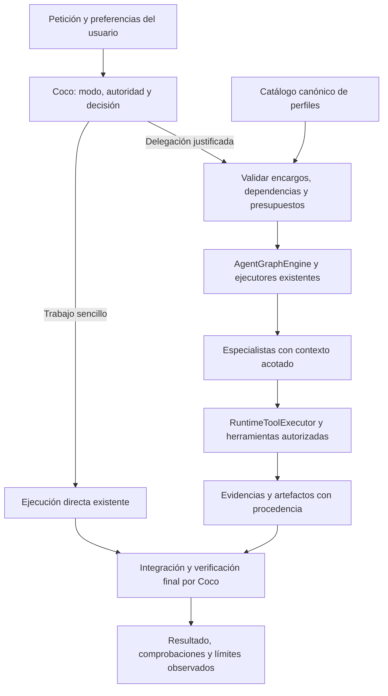

# Plan de agentes especialistas y delegación proporcionada

Fecha: 28 de octubre de 2026. Estado: **propuesta de implementación; no implementado**.
Base inspeccionada: Coco 3.0.1, commit `dc55b8f162aa429a0385e69c6635191e740c7186`.

## 1. Resultado esperado y alcance

Coco debe resolver directamente los trabajos sencillos, recurrir a especialistas cuando exista una ventaja identificable y coordinar partes independientes en paralelo. El usuario puede pedir un especialista, colaboración, secuencialidad o ejecución sin subagentes en lenguaje natural. Coco sigue siendo responsable del resultado integrado.

Esta entrega reutiliza el runtime nativo de TypeScript y los adaptadores actuales. Incluye perfiles preconstruidos, delegación explícita efectiva, selección automática conservadora, intercambio de evidencias, control de recursos y evaluación reproducible. No exige adoptar otro framework, proveedor, API de orquestación, base de datos o servicio distribuido.

**Criterio de éxito:** mejor aceptación funcional o menor tiempo en trabajos adecuados para delegación, sin introducir coordinación innecesaria en tareas simples ni debilitar permisos, recuperación o compatibilidad.

Fuera de la primera entrega: equipos descentralizados que negocian entre sí, subdelegación recursiva, marketplace de agentes, aprendizaje automático del router, cambios de modelo automáticos, ejecución desatendida entre clientes y worktrees automáticos. El paralelismo de implementación sobre el checkout compartido queda restringido a herramientas con alcance de escritura verificable; lo demás se serializa o devuelve propuestas de parche.

## 2. Referentes consultados y decisiones propias

Fuentes oficiales consultadas el 28-10-2026. Son referencias de diseño; no certifican la implementación de Coco ni prueban superioridad competitiva. No mezclar la configuración de OpenCode estable con su documentación V2.

| Fuente | Práctica documentada | Aplicación propuesta en Coco |
| --- | --- | --- |
| [OpenCode: agentes](https://opencode.ai/docs/agents/) | Agentes principales y subagentes; descripciones, herramientas y configuración por agente; invocación explícita. | Catálogo pequeño, perfiles identificables y selección explícita verificable de extremo a extremo. |
| [OpenCode: permisos](https://opencode.ai/docs/permissions/) | Decisiones `allow`, `ask`, `deny` y reglas sobre entradas concretas. | Mantener la frontera de ejecución de Coco y evaluar entradas reales; un perfil no otorga autoridad. |
| [OpenAI: multi-agent](https://developers.openai.com/api/docs/guides/agents-api/multi-agent) | Encargos acotados e independientes, coordinación central, concurrencia limitada y contexto propio. Crear un subagente no crea otro entorno de archivos. | Mantener tareas cortas/dependientes en el agente principal; distinguir aislamiento de contexto y de filesystem. Adoptar los principios, sin integrar obligatoriamente esta API. |
| [OpenAI: evaluación de agentes](https://developers.openai.com/api/docs/guides/agent-evals) | Inspeccionar trazas y después utilizar datasets y evaluaciones repetibles. | Evaluar decisiones de reparto, permisos, transferencias y resultado final; conservar fixtures y ejecuciones. |
| [OpenAI: trace grading](https://developers.openai.com/api/docs/guides/trace-grading) | Evaluar el recorrido completo para localizar fallos de comportamiento. | Registrar eventos y evidencias observables; no almacenar razonamiento privado ni exigir cadenas de pensamiento. |
| [Claude Code: subagentes](https://code.claude.com/docs/en/sub-agents) | Contexto propio, perfiles enfocados, herramientas limitadas y descripciones que ayudan a seleccionar al especialista. | Contexto mínimo relevante, criterios concretos de uso y permisos limitados. Una revisión separada no equivale a independencia empresarial. |
| [Anthropic: Building effective agents](https://www.anthropic.com/research/building-effective-agents) | Empezar con la solución sencilla; routing, paralelización y coordinador/trabajadores según necesidad. | Delegar por beneficio esperado y dependencias; evitar una cadena fija de agentes para cada solicitud. |

Los límites numéricos y gates de este plan son **propuestas de producto e ingeniería**, no requisitos atribuidos a estos proveedores. La guía conceptual de Anthropic es de 2024; para detalles actuales de subagentes se utiliza la documentación de Claude Code.

## 3. Estado comprobado en el repositorio

| Pieza existente | Evidencia | Consecuencia para el plan |
| --- | --- | --- |
| Doce tipos: explore, plan, test, debug, review, architect, security, tdd, refactor, e2e, docs, database | [`agent-type.ts`](../../src/runtime/agent-type.ts), [`prompts.ts`](../../src/cli/repl/agents/prompts.ts) | Mejorar y ordenar; no presentar doce nombres como doce especialidades ya validadas. |
| Roles, tareas, presupuestos, artefactos, handoffs, estado compartido, grafos y gates | [`multi-agent.ts`](../../src/runtime/multi-agent.ts), ADR [009](../architecture/adrs/009-multi-agent-runtime-contracts.md) y [010](../architecture/adrs/010-reference-grade-multi-agent-runtime.md) | El runtime ya es la fuente canónica. No crear un segundo planificador/ejecutor de grafos. |
| Registros y prompts adicionales en ejecutor y REPL | [`executor.ts`](../../src/agents/executor.ts), [`manager.ts`](../../src/cli/repl/agents/manager.ts), [`runtime-agent-node-executor.ts`](../../src/runtime/runtime-agent-node-executor.ts) | Migrar por adaptadores; eliminar divergencia de perfiles sin romper las APIs públicas. |
| Definiciones `.claude/agents/` del desarrollo de Coco | [directorio](../../.claude/agents/) | Preservarlas. No son por sí mismas perfiles distribuidos del producto. No copiar ni sincronizar automáticamente instrucciones específicas de este repositorio. |
| `/agents run` añade una directiva textual y `/agents status` muestra un mensaje fijo | [`commands/agents.ts`](../../src/cli/repl/commands/agents.ts) | Hace falta intención estructurada y estado real. Una línea de chat no prueba que se haya ejecutado un subagente. |
| Alias de CLI y de runtime difieren | [`commands/agents.ts`](../../src/cli/repl/commands/agents.ts), [`agent-type.ts`](../../src/runtime/agent-type.ts) | Por ejemplo, `coder` pasa por `refactor` en el comando y por `debug` en el resolver compartido. Congelar la semántica de compatibilidad con tests antes de cambiarla. |
| Políticas y regresiones de delegación ya presentes | [`delegation-roles.test.ts`](../../src/runtime/delegation-roles.test.ts), [`delegated-authority.test.ts`](../../src/runtime/delegated-authority.test.ts), [`delegation-consumers.test.ts`](../../src/agents/delegation-consumers.test.ts) | Extenderlas. La mejora no debe volver a separar herramientas ofrecidas de autoridad efectiva. |
| `AgentRunner` tiene un ejecutor por defecto que devuelve aceptación textual | [`agent-runner.ts`](../../src/runtime/agent-runner.ts) | Comprobar alcance y consumidores. En ejecución real, faltar un ejecutor debe producir error explícito, nunca éxito por aceptación textual. Simulación solo explícita. |
| El grafo actual se detiene al detectar fallo de un lote | [`AgentGraphEngine.run`](../../src/runtime/multi-agent.ts) | No prometer que toda rama independiente continuará. Añadir política optativa de continuar ramas independientes, preservando fail-fast por defecto. |
| Campos de presupuesto no equivalen a enforcement completo | [`AgentBudget`](../../src/runtime/multi-agent.ts), runner, manager y executor | Hay límites de turnos y timeout en algunas rutas; hay que demostrar límites acumulados y concurrentes en todas las rutas afectadas. |
| Clasificador de solicitudes y enhancer de herramientas paralelas | [`classifier.ts`](../../src/cli/repl/prompts/classifier.ts), [`parallel.ts`](../../src/cli/repl/prompts/enhancers/parallel.ts) | Reutilizar señales útiles, pero no confundir tipo de petición, esfuerzo de razonamiento, herramientas paralelas y delegación multiagente. |
| Algunos prompts describen convenciones internas de Coco | [`prompts.ts`](../../src/cli/repl/agents/prompts.ts) | Los perfiles distribuidos deben respetar el proyecto del usuario; TypeScript/ESM/oxlint no deben imponerse a un repositorio Python o Java. |
| Cobertura global excluye varias superficies de delegación | [`vitest.config.ts`](../../vitest.config.ts) | La cobertura global no acredita esas rutas. Medir específicamente los módulos cambiados e ir retirando exclusiones justificadamente. |

El ensayo previo de [Coco frente a OpenCode](EXCELLENCE_RESULTS_2026-10-27.md) es antecedente, no baseline válido de esta mejora: tiene otro snapshot, muestra reducida y no conserva el harness completo. Se necesita una nueva línea base reproducible.

## 4. Diseño funcional

### 4.1 Un responsable y cuatro estrategias

El agente principal interpreta la petición, conserva la relación con el usuario, decide el reparto y entrega la conclusión integrada. No es necesario crear un agente adicional llamado «coordinador» para cada turno.

| Estrategia | Cuándo | Ejemplo |
| --- | --- | --- |
| `direct` | Objetivo localizado, trabajo corto o dependencias muy estrechas. | Corregir una condición y comprobar el caso límite. |
| `specialist` | Una especialidad aporta foco o separación de contexto. | Investigar un fallo o revisar un diff. |
| `sequential` | Hay entregables dependientes y cambiar de especialidad aporta valor. | Definir contrato → implementar → verificar. Puede bastar el agente principal para varios pasos. |
| `parallel` | Hay al menos dos encargos independientes con recursos compatibles. | Investigar dos hipótesis o modificar módulos con fronteras comprobables. |

Separar **modo** (`ask`, `plan`, `build`…), **preferencia de delegación**, **estrategia** y **esfuerzo del modelo**. `parallel` nunca convierte un modo de lectura en uno de escritura. Aumentar `reasoning.effort` no obliga a crear agentes.

### 4.2 Catálogo inicial y perfiles

Cinco perfiles principales, conservando los identificadores existentes mediante aliases/adaptadores explícitos:

| Perfil | Uso | Salida y límites |
| --- | --- | --- |
| Investigador (`explore`) | Búsqueda, comprensión e hipótesis. | Hallazgos con referencias, incertidumbres y próximos pasos. Sin escrituras; sin shell arbitrario. |
| Planificador/arquitecto (`plan`, `architect`) | Contratos, alternativas y descomposición cuando haga falta. | Plan mínimo, dependencias y aceptación. Lectura; evitar introducir capas sin necesidad. |
| Implementador (`editor` canónico; compatibilidad con debug/refactor/coder documentada) | Implementación y correcciones acotadas. | Cambios, explicación causal y comprobaciones focales. Sin refactor lateral. Añadir ID público `implement` solo mediante migración explícita, no renombrar silenciosamente los existentes. |
| Verificador (`test`, con variantes `tdd`/`e2e`) | Probar comportamiento y detectar regresiones. | Comandos observados, resultados y carencias. Permitir editar tests dentro de su alcance; no modificar producción para hacer pasar tests sin reasignación. |
| Revisor (`review`) | Examinar un resultado con contexto separado. | Hallazgos accionables por severidad, o ausencia de hallazgos dentro del alcance revisado. No emitir garantía de corrección por una nota. |

Seguridad, base de datos y documentación permanecen como especialistas optativos y se validan sobre sus tareas. Frontend/backend son capacidades o instrucciones de proyecto antes de convertirse en nuevos agentes. `optimizer` sigue disponible por compatibilidad, sin activarse por defecto en cada cambio.

Cada definición debe declarar: ID estable, versión, descripción breve, cuándo usar/no usar, instrucciones, herramientas necesarias, alcance permitido, contrato de salida, límites y política de verificación. Modelo y esfuerzo heredan la selección del usuario salvo configuración expresa compatible con el proveedor. Nada de fijar versiones de modelos desde prompts.

Mejoras editoriales concretas: sustituir «production-ready», «cobertura alta» o «aplicar mejores prácticas» como objetivos vagos por criterios observables; priorizar comportamiento frente a un test por método; no imponer «una aserción por test»; hacer opcional TDD según el cambio; no añadir tests de bajo valor para satisfacer una cifra. Cargar instrucciones del repositorio objetivo y su jerarquía de confianza, no las convenciones del repositorio de Coco.

### 4.3 Selección automática conservadora

Orden de decisión:

1. Resolver autoridad del host y modo activo. Si la delegación no está disponible, explicar la limitación y seguir directamente solo dentro de la autoridad existente.
2. Extraer la preferencia explícita del usuario: sin subagentes, especialista concreto, colaboración o secuencialidad. La petición de más agentes no concede herramientas nuevas ni presupuesto ilimitado.
3. Explorar lo mínimo necesario. No llamar siempre a un clasificador LLM aparte; aprovechar la decisión estructurada del turno principal y validarla en el host.
4. Evaluar incertidumbre, riesgo, dependencias, posibilidad de aislar contexto, solapamiento de recursos y presupuesto. No usar el tamaño del mensaje ni el número de archivos como criterio único.
5. Elegir `direct` ante evidencia insuficiente. Escalar después si aparece una investigación independiente o una revisión útil. La ambigüedad de requisitos se resuelve aclarando el requisito, no multiplicando agentes.
6. Validar propuesta: perfiles disponibles, dependencias acíclicas, scopes compatibles, límites y criterio de aceptación. Rechazar una propuesta inválida con motivo legible; como máximo una corrección acotada antes de volver al camino directo cuando sea seguro.
7. Explicar una delegación real en una frase: reparto, motivo y dependencias. Reevaluar ante steering del usuario sin invalidar ni repetir efectos completados.

No construir una puntuación numérica de complejidad con falsa precisión. Guardar motivos enumerados y señales observables. Las reglas iniciales se calibran con casos etiquetados; cambios posteriores deben mejorar evaluaciones reservadas.

### 4.4 Controles de usuario y configuración propuesta

Extender el `/agents` actual; no crear otro sistema de comandos. Conservar `list` y `run <perfil> <tarea>`, pero hacer que `run` use intención tipada y ejecución real. Añadir `mode off|manual|auto`, `status`, `cancel <runId|all>` y `explain [runId]` solo cuando estén conectados al estado real. Mensajes y comandos deben tener el mismo efecto.

Semántica propuesta: `off` prohíbe nuevas delegaciones; `manual` permite peticiones explícitas del usuario; `auto` permite selección proporcionada. Preferencias explícitas posteriores pueden actualizar el modo de sesión, salvo restricciones del host/administrador; reflejar el cambio. Una preferencia de un turno no se convierte en preferencia permanente sin indicarlo.

Primera distribución: selección automática desactivada, manteniendo compatibilidad de integraciones que ya llaman herramientas de delegación. Aplicar `manual` inicialmente a la nueva experiencia conversacional, sin revocar silenciosamente autoridad de embedders existentes. Definir y probar precedencia: host/administrador → preferencia explícita vigente → configuración de sesión → proyecto → valor por defecto.

Configuración candidata, a introducir en el esquema canónico localizado durante P0, no como JSON paralelo:

```ts
// Contrato propuesto, no API disponible actualmente.
interface DelegationOptions {
  mode: "off" | "manual" | "auto";
  maxConcurrentWorkers: number; // Inicial: 2; el agente principal no cuenta aquí.
  maxWorkersPerTask: number; // Inicial: 4, contando reemplazos.
  maxDepth: number; // Inicial: 1; los workers no pueden subdelegar.
  failurePolicy: "fail-fast" | "continue-independent";
}
```

Presupuesto de turnos/tokens/tiempo se deriva del presupuesto real del trabajo padre y se reserva entre workers; no se multiplica por agente. Mantener límites existentes del producto como techo. Conservar `fail-fast` para consumidores actuales; el nuevo coordinador puede elegir explícitamente `continue-independent`. Estos valores iniciales se afinan con mediciones, no con intuición comercial.

### 4.5 Transferencias, evidencias y contexto

Extender `AgentTask`, `AgentArtifact`, `AgentHandoff` y `AgentRunResult` de forma compatible. Evitar crear otro «bus» de mensajes. Campos nuevos opcionales en APIs antiguas y validados al entrar en la nueva ruta.

Encargo: objetivo, criterios de aceptación con IDs, referencias relevantes, restricciones del usuario, versión del estado de trabajo, dependencias, alcance de lectura/escritura, presupuesto y entregables esperados. Recibir información no equivale a recibir autoridad.

Resultado: resumen, hallazgos o cambios, referencias de artefactos, comandos y recibos de verificación emitidos por el host, estado de efectos, incertidumbres y bloqueos. Distinguir ejecución terminada, cambios aplicados y aceptación verificada. El host valida esquema y procedencia; un worker no puede inventar un recibo válido.

No compartir toda la conversación ni logs de shell por defecto. Pasar contexto relevante con referencias recuperables y origen, preservando instrucciones del usuario y del proyecto. Limitar tamaño y compactar con el mecanismo existente, conservando pares llamada/resultado. No volcar secretos en contexto compartido ni en trazas.

El siguiente especialista consume únicamente los artefactos necesarios de dependencias satisfechas. Los mensajes entre workers son actualizaciones de tarea con procedencia; no pueden modificar el prompt de sistema ni ejecutar herramientas directamente. La revisión recibe requisitos, diff y comprobaciones, sin instrucciones de «confirma lo que dijo el implementador».

### 4.6 Ejecución, recursos y recuperación

Aplicar capacidad efectiva como intersección de autoridad del host/padre, modo activo, perfil, tarea y política de entradas. Una denegación del padre no se evita mediante un hijo. El modo de lectura bloquea también efectos alcanzables por shell, MCP, aliases o delegación anidada.

Primera versión: concurrencia para lecturas independientes y escrituras disjuntas mediante herramientas que comprueben scope. Serializar instalaciones, lockfiles, índice Git, builds sobre el mismo directorio, migraciones y shell con efectos no acotables. Un test también puede escribir snapshots, cachés o consultar servicios: no etiquetarlo universalmente como lectura. Un contrato API compartido se acuerda antes del fan-out.

Usar un pequeño control de propiedad por recurso dentro del coordinador local. No confundir este control con un lock entre procesos ni con sandbox del SO. Proteger frente a cambios del usuario u otro proceso mediante precondiciones de contenido/revisión antes de aplicar un parche; ante discrepancia, detener e integrar conscientemente. Las herramientas que no pueden demostrar alcance se ejecutan en serie.

Reutilizar eventos, `SessionStore` y journal del ADR [011](../architecture/adrs/011-durable-conversations-and-work-evidence.md). Guardar antes de despachar efectos y al recibir resultados. Si se produce un efecto sin resultado durable, marcarlo incierto y requerir reconciliación observada; nunca repetirlo automáticamente. Un checkpoint no convierte los efectos externos en una transacción ni garantiza reanudar todo un grafo.

Estados de tarea nuevos o derivados: pendiente, ejecutando, completada, fallida, bloqueada por dependencia, cancelada y resultado incierto. El estado de verificación es separado. Mantener compatibilidad con los estados públicos actuales mediante proyección explícita. Un fallo bloquea descendientes; ramas independientes solo continúan bajo la política elegida. El resultado global no puede ser éxito si queda aceptación obligatoria pendiente.

Reservar presupuesto antes de nuevas llamadas; contabilizar coordinador y workers, reintentos y llamadas fallidas cuando haya uso disponible. Si no se conoce el consumo, registrarlo como desconocido/estimado. Límites de salida: comprobar serialización real del adaptador cuando se anuncien como duros; si el proveedor no permite garantizarlos, documentar la limitación y no ofrecer garantía monetaria. Cancelar llamadas y procesos con los mecanismos existentes y no liberar propiedad de recursos antes de su terminación efectiva.

## 5. Arquitectura y archivos de intervención



Extensiones propuestas, nombres orientativos:

| Área | Intervención |
| --- | --- |
| `src/runtime/agent-profiles.ts` nuevo | Catálogo distribuido, esquemas, aliases y validación. Perfiles TS pequeños inicialmente; sin cargador genérico nuevo. |
| `src/runtime/delegation-policy.ts` nuevo | Preferencias y validación determinista de propuestas de reparto. Sin clasificador LLM obligatorio. |
| `src/runtime/multi-agent.ts` y módulos extraídos al tocarlo | Extender contratos y política de fallos; conservar exports. Dividir solo lo necesario, no reescribir el módulo completo. |
| `runtime-agent-node-executor.ts`, `agent-runner.ts` | Selección por ID/perfil, ejecutor real y error explícito si falta; aplicación de presupuestos. El registro actual tiene un único valor por rol: añadir selección por ID para futuras variantes, manteniendo fallback antiguo. |
| `src/agents/*`, `src/cli/repl/agents/*` | Adaptadores del catálogo y ejecución canónica; mantener funciones públicas. |
| `src/tools/simple-agent.ts`, `src/tools/agent-coordinator.ts` | Misma validación de entrada, identidad, autoridad, perfiles y resultados. Nada de ejecución alternativa escondida. |
| `src/cli/repl/commands/agents.ts`, `types.ts`, `agent-loop.ts` | Intención tipada, estado, steering, UX y puente al runtime. Mantener las decisiones comunes fuera de la CLI. |
| Configuración existente y `src/runtime/index.ts` | Validación, migración de preferencias y exportación pública mínima para embedders. |
| Ledger, store y eventos existentes | Reutilización con campos versionados; no una segunda persistencia del plan. |
| `test/fixtures/delegation/`, `test/e2e/`, `test/benchmarks/` | Casos reproducibles, simulación explícita y harness conservado. Nombres y scripts finales se fijan en P0. |

Compatibilidad: no modificar `.claude/` como efecto colateral, mantener `@corbat-tech/coco/runtime`, aliases existentes y resultados legacy; añadir advertencias de migración cuando sea necesario. No cambiar `coco build`/`resume` para aparentar autonomía de fases: queda fuera de alcance.

## 6. Secuencia de implementación y condiciones de avance

Cada fase termina con código revisable, tests focales y evidencia de su gate. No iniciar automatismo antes de que la delegación explícita funcione de extremo a extremo.

| Fase | Trabajo y entregable | Dependencias | Gate de salida |
| --- | --- | --- | --- |
| P0 · Contrato y baseline | Inventario de consumidores reales, registro de defaults/simulaciones, mapa de configuración y autoridad; especificación de UX y aceptación; corpus y harness versionados; ADR que extienda 009–011. Capturar baseline antes de cambios. | Ninguna | Ejecución directa reproducible; casos de fallo existentes identificados; criterios y holdout congelados. |
| P1 · Catálogo y compatibilidad | Catálogo canónico, cinco perfiles principales y variantes, instrucciones independientes del proyecto, aliases únicos y adapters. Validar herramientas existentes y esquemas. | P0 | Las dos herramientas, CLI y ejecutor resuelven el mismo perfil; snapshots de compatibilidad; ninguna definición concede autoridad. |
| P2 · Delegación explícita real | Sustituir directiva textual por intención tipada; conectar al ejecutor real; estado y cancelación; fallar si falta executor; simulación explícita en tests/dry-run. | P1 | Desde CLI/runtime se observa una llamada real del worker y su efecto autorizado; pedir especialista no se satisface solo cambiando el prompt principal. |
| P3 · Transferencias y aceptación | Contratos de entrada/salida, artefactos con procedencia, dependencias, recibos y revisión de cambios vigentes. | P2 | Flujo investigador → implementador → verificador conserva restricciones; evidencia inventada/obsoleta no acredita éxito. |
| P4 · Paralelismo limitado | Concurrencia global y por trabajo, reserva de recursos/presupuestos, solapamientos, política de fallos explícita, timeout y cancelación. | P3 | Dos lecturas independientes se solapan; escrituras incompatibles no; límites sobreviven a errores y cancelación; no hay éxitos agregados falsos. |
| P5 · Recuperación y observabilidad | Integrar journal, resultados inciertos, estado persistente, explicación de reparto, redacción y métricas acumuladas. | P4 | Reapertura coherente, sin efectos duplicados ni pérdida de evidencia; estado mostrado coincide con store/eventos. |
| P6 · Decisión automática | Política conservadora, intención en español/inglés, reevaluación y fallback; modo shadow sin despachar workers adicionales. | P3–P5 | Off/manual/auto y steering cumplen precedencia; casos simples permanecen directos; decisión inválida no ejecuta efectos. |
| P7 · Evaluación y piloto | Ejecutar corpus pareado, revisión del producto instalado y ensayos multi-provider; corregir con casos de desarrollo, no con holdout. | P6 | Gates de fiabilidad y beneficio de la sección 9; si no pasan, publicar manual únicamente y mantener auto desactivado. |
| P8 · Distribución | Guía, ejemplos, configuración, smoke del paquete y adaptadores, release gate y notas con limitaciones; piloto optativo y rollback. | P7 | Matriz de aceptación completa, artefactos conservados y activación reversible. Publicar queda separado de implementar. |

Propuesta de PRs: uno por fase o por corte vertical comprobable; combinar P4/P5 solo si la atomicidad del contrato lo exige. No aprobar una fase por tener solo interfaces, mocks o documentación. Evitar un PR gigante con catálogo, scheduling, recuperación y automatismo simultáneos.

## 7. Flujo de desarrollo con IA para ejecutar el plan

1. **Preparar:** revisar `AGENTS.md`/`CLAUDE.md`, estado de Git y cambios del usuario. Crear rama de trabajo adecuada al repositorio. Registrar commit base y entorno; no tocar credenciales o versiones globales para probar.
2. **Especificar un corte pequeño:** objetivo, exclusiones, interfaces, criterios observables, riesgos concretos y tests que pueden refutarlo. Actualizar el plan al descubrir hechos, no añadir capas preventivas sin consumidor.
3. **Explorar:** buscar implementaciones y tests existentes. Reutilizar contratos. Si el trabajo es sencillo, hacerlo con un solo agente; si se delega durante la implementación, asignar archivos y aceptación y respetar la autorización vigente de la sesión.
4. **Reproducir:** para un bug o contrato crítico, escribir primero una regresión que falle por la causa correcta. Para prompts, preparar ejemplos y contraejemplos. No exigir TDD ceremonial para cambios triviales ni tests que solo repitan la implementación.
5. **Implementar:** cambios mínimos, tipos estrictos, validación en fronteras, excepciones y cancelación explícitas. No instalar frameworks por conveniencia del agente. No sustituir checks por una autoevaluación textual.
6. **Verificar durante edición:** tests focales del comportamiento modificado. Comprobar invariantes de permisos, errores y recuperación cuando se toquen. No ejecutar toda la suite tras cada archivo.
7. **Revisar:** inspeccionar diff y contratos; revisión separada para cambios de autoridad, concurrencia, persistencia o APIs. Un revisor IA es apoyo; basar aceptación en código y resultados observados. Corregir hallazgos relevantes y repetir únicamente lo afectado.
8. **Integrar:** ejecutar gate completo al cerrar el corte, o en CI equivalente sin duplicación innecesaria. Probar el artefacto construido cuando se toquen exports, empaquetado o CLI. Nunca afirmar que el source test demuestra el paquete instalado.
9. **Documentar:** comportamiento final, ejemplos ejecutables, limitaciones y migración. El informe debe decir qué cambió, por qué, qué se comprobó y qué sigue sin demostrarse.
10. **Entregar:** commit/PR según autorización, evidencias ligadas al SHA y configuración. No publicar ni activar automatismo por cumplir solo cobertura. Mantener una vía rápida para desactivar selección automática.

## 8. Estrategia de pruebas

### 8.1 Matriz determinista: obligatoria en CI, sin servicios de pago

Usar proveedor guionizado, temporales, barreras de concurrencia y efectos observables. No validar paralelismo con sleeps frágiles ni comparar el texto exacto de respuestas libres.

| Grupo | Casos mínimos | Resultado exigido |
| --- | --- | --- |
| Catálogo | Todos los perfiles y aliases; herramientas inexistentes; ID inválido; configuración antigua. | Resolución coherente; errores claros; no fallback que cambie silenciosamente la intención. |
| Intención | «hazlo solo», «sin agentes», «usa agentes», «revisión independiente», español/inglés; negación, citas y texto pegado malicioso. | Respetar intención del usuario; contenido de archivos no cambia preferencias ni concede autoridad. |
| Routing | Cambio pequeño, tarea ambigua, grafo dependiente, partes independientes, decisión malformada y presupuesto insuficiente. | Estrategia proporcional, validada antes de ejecutar; no clasificador remoto obligatorio. |
| Extremo a extremo | `/agents run`, solicitud natural y API embebida con provider guionizado. | Worker realmente ejecutado, herramientas invocadas, resultado y estado observables. |
| Autoridad | `plan`/`review`, wrappers, shell, MCP, rutas fuera de scope, symlinks y subdelegación. | Cero efecto denegado; la autoridad del hijo nunca excede la del padre. |
| Transferencias | Restricción literal, cambio de API, evidencia inventada, JSON inválido, datos de otro trabajo y contexto demasiado largo. | Mantener instrucciones legítimas; rechazar procedencia/esquema inválido; no mezclar sesiones. |
| Dependencias | Ciclo, prerequisito fallido, rama independiente y fallo de gate obligatorio. | Bloqueo explícito de descendientes; política de fallos respetada; ningún éxito global indebido. |
| Concurrencia | Dos lectores, escritores disjuntos, mismo archivo/lockfile/índice Git, cambio externo entre lectura y aplicación. | Solapamiento solo permitido; conflicto detectado antes de sobrescribir; serialización donde no haya garantía. |
| Presupuesto | Dos workers compitiendo por saldo; último turno; uso desconocido; reintento y respuesta truncada. | Reservas atómicas locales; ninguna nueva llamada tras agotar presupuesto; límites no garantizables declarados. |
| Cancelación | En cola, durante proveedor, durante herramienta y tras efecto. | No nuevas llamadas; terminación observada antes de liberar recursos; efectos previos conservados en evidencia. |
| Recuperación | Caída antes/después de inicio, efecto sin resultado durable, reapertura y reconciliación. | Sin replay silencioso de efectos; incertidumbre visible; aislamiento por sesión/trabajo. |
| Verificación | Test aprobado y luego edición; worker declara éxito sin test; fallo de test; requisito no cubierto. | Invalidar evidencia obsoleta; separar observado de declarado y de aceptación semántica. |
| Privacidad y UX | Logs con secretos, resúmenes largos, estado/cancelación e interrupción del usuario. | Redacción, tamaño limitado, estado real y respuesta integrada sin inundar el chat. |
| Compatibilidad | API antigua, aliases, exports, REPL, workflow y smoke headless. | Cambios compatibles documentados; no dependencia del runtime hacia la CLI para decidir reparto. |

### 8.2 Pruebas de integración y del paquete

Reutilizar y extender `delegation-roles`, `delegated-authority`, `delegation-consumers`, `coordinator-cancellation`, `manager-cancellation`, `graph-cancellation`, `permission-effects`, `work-ledger`, `session-recovery` y pruebas de fitness existentes según los módulos tocados. Confirmar los nombres reales antes de crear archivos nuevos.

Ejecutar un escenario completo sobre un repositorio temporal: investigar → implementar → verificar → revisar; otro con dos ramas independientes y agregación; y otro que falla/cancela después de un efecto. Inspeccionar archivos, llamadas, estado y recibos, no solo mocks de `success: true`.

Construir/empaquetar e instalar en un consumidor temporal. Verificar que los perfiles se distribuyen y funcionan sin `.claude/` del repositorio, que los exports públicos siguen disponibles y que CLI y embedders comparten política. Comprobar smoke en plataformas soportadas; no ampliar promesas de Windows sin evidencia.

Comandos existentes, a ejecutar durante implementación y no como supuesto resultado de este documento:

```sh
# Regresiones focales; ajustar a los archivos modificados.
pnpm exec vitest run src/runtime/delegation-roles.test.ts src/agents/delegation-consumers.test.ts

# Gate integrado existente: tipos, lint, formato, suite con cobertura,
# integración REPL separada y build. No sustituirlo por pnpm check solamente.
pnpm check:release

# Si cambian exports o contratos consumidos por apps:
pnpm typecheck:apps
```

Usar el runtime de desarrollo/release documentado en el repositorio (Node 24 LTS) y verificar la compatibilidad mínima Node 22.13 para las rutas nuevas. No rebajar umbrales ni añadir skips para conseguir verde. Los checks conocidos previos se distinguen de nuevas regresiones; una prueba relevante saltada no se considera evidencia pasada.

Cobertura actual configurada: líneas/statements 80%, funciones 72%, ramas 57%. Mantenerla y exigir para nuevos módulos de política/contratos al menos 90% de líneas y 85% de ramas con casos significativos. Medir explícitamente las rutas de delegación afectadas que hoy estén excluidas; ampliar cobertura progresivamente, sin atribuirles la cifra global. Los umbrales no reemplazan la matriz de comportamiento.

## 9. Evaluación con modelos reales y criterios de producto

### 9.1 Corpus y diseño del experimento

Preparar 36 tareas versionadas: 12 sencillas/localizadas, 8 con dependencias, 10 con partes paralelizables y 6 de fallo/recuperación/autoridad. Repartir de forma estratificada 24 para desarrollo y 12 reservadas; los criterios reservados quedan congelados antes de P1. Las pruebas deterministas cubren exhaustivamente seguridad y scheduling; el modelo real complementa, no reemplaza, esos contratos.

Cada caso especifica repositorio/snapshot, petición y steering, estrategia aceptable (puede haber varias), restricciones, pruebas públicas, aceptación reservada, recursos y límite. Incluir código de al menos un repositorio ajeno a Coco y casos sin convenciones TypeScript. No declarar certificación multilenguaje por un smoke de Python/Java.

Comparar: A) baseline directo congelado, B) especialistas explícitos/secuenciales, C) selección automática. Misma tarea y snapshot inicial, modelo/versión y esfuerzo, herramientas, entorno y presupuesto total por trabajo. Los límites son globales por configuración: varios agentes no reciben cada uno el presupuesto íntegro de A. Registrar además las políticas/plantillas por hash. Alternar orden de ejecución y usar copias limpias para evitar contaminación.

Secuencia económica: smoke pequeño para arreglar el harness; piloto con 12 casos × 3 configuraciones × 3 repeticiones = 108 ejecuciones; ampliación al corpus de 36 solo cuando el presupuesto y el piloto lo justifiquen (324 ejecuciones para tres repeticiones y tres configuraciones). Registrar por separado smoke, tuning y puntuación. Esta planificación **no ejecuta llamadas pagadas**; antes de cada campaña fijar límite total de uso y duración según la autorización vigente.

La comparación opcional con OpenCode usa un subconjunto congelado, versión exacta instalada y permisos equivalentes, anotando diferencias inevitables. No es gate de esta entrega ni un ranking del mercado. Probar un segundo proveedor sobre un subconjunto para comprobar portabilidad; diferenciar fixture del adaptador y llamada real. No exigir llamadas comerciales de todos los proveedores en cada CI.

### 9.2 Qué medir

Primaria: aceptación funcional externa por tarea, requisitos conservados y ausencia de acciones no autorizadas. Complementarias: regresiones, falso completado, estrategia elegida, delegación innecesaria, conflictos de escritura, intervención humana, tiempo total, llamadas, tokens acumulados/coordinador/workers y uso desconocido. Coste solo con tarifas/contabilidad verificables; una suscripción no implica coste cero.

Contabilizar todas las repeticiones, timeouts y fallos de proveedor sin reintentos favorables ocultos. Informar errores del harness aparte con motivo y preservar intentos. Mostrar resultados por tipo de tarea, mediana y dispersión; intervalos/estimaciones agrupados por tarea, sin tratar repeticiones del mismo caso como tareas independientes. No usar p95 de una muestra diminuta para proclamar fiabilidad. Una nota de otro LLM es evidencia auxiliar; no sustituye tests ni se presenta como auditoría humana independiente.

Conservar scripts, fixtures, criterios, salida estructurada, manifiesto de entorno y registros saneados ligados a SHA. Excluir credenciales y código privado no autorizado. La reproducción exacta de textos no está garantizada, pero sí debe poder ejecutarse el protocolo y revisar su puntuación. Los casos reservados no se usan para editar prompts; tras una iteración basada en ellos, sustituirlos para la siguiente evaluación independiente.

### 9.3 Gates propuestos de aceptación

Estos objetivos se congelan en P0. Si el baseline demuestra que un valor no es viable, renegociarlo antes de desarrollar y registrar la razón; no moverlo después de ver el holdout.

| Gate | Expectativa |
| --- | --- |
| G1 · Simplicidad | En fixtures, cero workers para las tareas sencillas etiquetadas como directas y para `off`. En casos reales sencillos, delegación innecesaria ≤5%; sin nueva llamada obligatoria de clasificación. |
| G2 · Control explícito | 100% de casos deterministas cumplen preferencias, límites del host y aliases. La petición explícita produce la estrategia o explica por qué no puede ejecutarse. |
| G3 · Autoridad | Cero efectos no autorizados en la matriz y cero bypasses conocidos abiertos. Cualquier violación bloquea distribución de la ruta afectada. |
| G4 · Fiabilidad | Todas las regresiones de dependencias/cancelación/recuperación pasan; cero éxito por executor ausente, respuesta truncada o evidencia fabricada. |
| G5 · Calidad | En la muestra pareada, auto no empeora la tasa de aceptación agregada ni pierde ningún criterio crítico frente a directo; analizar diferencias caso a caso y su incertidumbre. Sin evidencia suficiente, auto continúa optativo. |
| G6 · Beneficio | En tareas paralelizables, mediana de tiempo total al menos 20% menor, sin perder aceptación, con tokens agregados medianos ≤2× directo y dentro del presupuesto global. Si aporta calidad en vez de velocidad, documentarlo y activar solo para esa clase con criterios acordados previamente. |
| G7 · Sobrecoste simple | Cero nuevos workers/llamadas de routing; overhead local de decisión objetivo <10 ms de mediana y <50 ms p95 en 1.000 mediciones locales con entorno declarado. Informar por separado latencia de proveedor. |
| G8 · Trazabilidad | Cada delegación explica su motivo y enlaza encargo, perfil/versionado, resultado, estado y checks. Estado de CLI y estado durable coinciden en pruebas. |
| G9 · Compatibilidad | Gate de release, consumidor instalado, Node mínimo y smoke de plataformas afectadas pasan sin nuevos skips relevantes. |

Estos gates no garantizan que cualquier tarea futura sea correcta ni que el 20% se mantenga en otro proveedor. Delimitan cuándo esta implementación merece activarse con los datos disponibles.

## 10. Matriz final de demostración al usuario

| Petición de demostración | Comportamiento correcto | Evidencia que se entrega |
| --- | --- | --- |
| «Corrige este mensaje» | Camino directo. | Diff acotado; sin runs de workers. |
| «Explícame este módulo» | Lectura directa, sin flujo de implementación. | Referencias consultadas; cero escrituras. |
| «Revisa autenticación con un especialista» | Revisor/security con alcance de lectura. | Run real, hallazgos y límites; cero cambios no autorizados. |
| «Investiga estas dos hipótesis en paralelo» | Dos investigadores sobre encargos independientes. | Eventos de solapamiento, resultados y síntesis fundamentada. |
| «Implementa API y cliente usando agentes» | Contrato primero; reparto solo donde exista independencia y herramientas acotadas. | Contrato, propiedad de archivos, pruebas por parte y test de integración. |
| «Hazlo sin subagentes» | Se detienen nuevas delegaciones; se reconcilia trabajo ya iniciado. | Preferencia efectiva y ausencia de nuevos spawns. |
| «Primero diseña y luego implementa» | Dependencia explícita; no ejecutar implementación prematuramente. | Orden de eventos y versión del contrato utilizada. |
| «Para» durante un efecto | Cancelación observada; resultado incierto si corresponde. | Estado honesto y procedimiento de reconciliación, sin replay automático. |
| Reabrir tras caída | Recuperar estado conocido; bloquear lo incierto. | Journal, resultado vigente y ausencia de efecto duplicado. |

## 11. Despliegue gradual y rollback

1. Integrar catálogo y delegación explícita manteniendo auto desactivado.
2. Ejecutar política automática en shadow: observar propuestas sin crear workers ni llamadas remotas adicionales solo para clasificación.
3. Pilotar auto mediante opt-in con presupuestos y perfiles versionados; registrar motivos de vuelta a directo.
4. Revisar métricas y fallos; habilitar únicamente las clases de trabajo con ventaja demostrada. No convertir todas las tareas en un grafo visible al usuario.
5. Ante violación de autoridad, replay de efectos o pérdida de evidencia, desactivar la ruta afectada. Desactivar auto no detiene mágicamente workers ni deshace cambios: cancelar, esperar terminación, reconciliar y devolver estado real.

La primera release puede ser satisfactoria con especialistas explícitos bien implementados y automatismo todavía optativo. No bajar los gates para anunciar «multiagente autónomo».

## 12. Definición de terminado y expectativas

- [ ] Un catálogo distribuido y adaptadores sin divergencia de perfiles ni aliases sin documentar.
- [ ] Perfiles útiles en proyectos del usuario y fuera del repositorio de Coco.
- [ ] Delegación explícita comprobada desde chat/CLI y runtime, no solo directivas de prompt.
- [ ] Selección automática conservadora, configurable, explicable y reversible.
- [ ] Encargos y resultados tipados, contexto acotado y procedencia verificable.
- [ ] Paralelismo real para tareas compatibles; conflictos serializados y dependencias respetadas.
- [ ] Presupuestos acumulados, cancelación, errores e incertidumbre de efectos correctamente tratados.
- [ ] Resultado integrado respaldado por checks actuales, sin confundir una opinión de modelo con aceptación.
- [ ] Suites, regresiones, paquete instalado y compatibilidad verificados.
- [ ] Harness y evidencias conservados; resultados por clase de tarea y limitaciones publicados en el informe de la entrega.
- [ ] Documentación de uso/migración completa; ninguna promesa nueva de sandbox, transacción distribuida o autonomía universal.

Expectativa realista: especialistas más consistentes, mejor reparto de investigaciones y cambios separables, y mayor visibilidad de fallos. No se promete que más agentes mejoren todos los trabajos ni que perfiles expertos sustituyan experiencia humana, requisitos claros o pruebas del software resultante.

## 13. Validación de este documento

Plan basado en lectura de los archivos y fuentes enlazados. No se ha implementado la funcionalidad, ejecutado una nueva evaluación de modelos ni publicado una release durante su preparación. La verificación del documento comprende referencias locales, estructura y limpieza del diff; los resultados de implementación se registrarán por fase y SHA.
